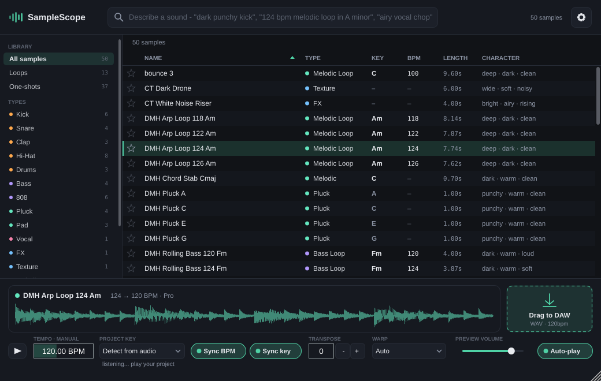
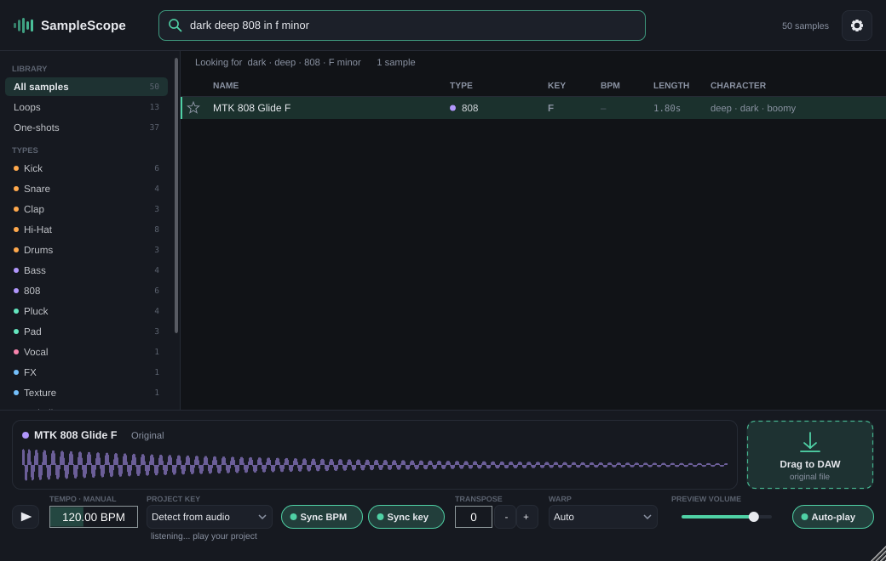

# SampleScope

A sample-library browser that runs as a **VST3** inside your DAW. It indexes your sample folders, works out what every sample *is* (type, key, tempo, character), lets you search in plain words, plays samples **in time and in key with your project**, and lets you **drag the synced version straight into the arrangement**.





## Build & install (macOS)

Requirements: Xcode command-line tools and CMake (the script offers to install both).

```bash
cd SampleScope
./build-mac.sh          # builds a universal (Apple Silicon + Intel) VST3 and installs it
./build-mac.sh --test   # same, but builds and runs the test suite first
```

The first run downloads JUCE 9.0.3 and Signalsmith Stretch 1.4.0 (pinned versions) and takes a few minutes. The plug-in is installed to `~/Library/Audio/Plug-Ins/VST3/SampleScope.vst3`. In Ableton Live: *Settings → Plug-Ins → Use VST3 Plug-In System Folders → Rescan*.

**Other platforms / no local toolchain:** push the folder to a GitHub repo. The included workflow (`.github/workflows/build.yml`) builds, tests and pluginval-validates macOS-universal and Windows VST3s, and attaches them as downloadable artifacts.

## Using it in Ableton Live

1. **Drop SampleScope on the Master track.** It passes audio through untouched; it only *listens* (for key detection) and adds the preview on top.
2. Click **Choose a folder…** (or a suggested one such as `~/Splice/sounds`). Indexing runs in the background on low-priority threads, and samples appear as they're analysed.
3. **Search by describing the sound:** `dark punchy kick`, `124 bpm melodic loop in A minor`, `airy vocal chop`, `rising noise fx`, `808 in f`, `wide lush pad`, `tight hats loop`.
4. Select a sample to hear it **already warped to the project tempo and transposed to the project key**. While Live is playing, loops are phase-locked to the song position, so they land on the beat.
5. **Drag** the row (or the *Drag to DAW* tile) into an audio track. You get the synced version as a file, or the untouched original when nothing needed changing.
6. ★ adds to the selected list. Make lists with **+** next to LISTS, or drop rows onto a list.

| Shortcut | Action |
|---|---|
| `/` or `⌘F` | focus search |
| `↑ ↓` (also from the search box) | move through results (auto-plays) |
| `Return` / double-click / click again | play |
| `Space` | play / stop |
| `F` | favourite the selected sample |
| right-click a row | find similar sounds, add to list, show in Finder, re-analyse |

## How each requirement is met

| # | Requirement | Implementation |
|---|---|---|
| 1 | Scan & categorise by sonic profile | `AudioAnalyzer`: 22.05 kHz mono analysis. Measures envelope (attack, decay, crest), spectrum (centroid, band energies, in-band flatness), harmonic/percussive separation, onset density, YIN pitch, chroma (tuning-compensated), tempo (onset autocorrelation plus "loops are cut to whole bars"). It sorts samples into 21 types (Kick, Snare, Clap, Hi-Hat, Cymbal, Tom, Perc, Drums, Bass, 808, Lead, Pluck, Pad, Keys, Guitar, Strings, Brass, Vocal, FX, Texture, Melodic), loop vs one-shot, and 24 descriptor tags (bright, dark, punchy, warm, airy, deep, gritty, wide, rising…). Audio evidence is fused with file/folder-name evidence ("Kick", "Am", "128bpm"), which sample packs usually get right. |
| 2 | Search with any description | `SearchEngine`: parses types, tempo (`124 bpm`, `120-130 bpm`), keys (`am`, `a minor`, `in F`, `c sharp minor`), loop/one-shot words, ~180 descriptive words mapped to the sonic profile and ~220 type words (`dark` = low centroid, `punchy` = crest × fast attack, …), and name words. If nothing matches exactly it relaxes key → tempo → type and says so, instead of showing an empty list. "Find similar sounds" ranks by profile distance. |
| 3 | Sync to project BPM & key | Tempo comes from the host. Key: VST3 doesn't give plug-ins the project key (Live shares its Scale only with Live's own devices), so SampleScope **listens** to the audio passing through it (and any MIDI routed to it) and keeps a running key estimate. You can also pick the key manually. Loops are stretched with bar-exact lengths, and half/double time is folded (a 70 BPM loop in a 140 set isn't squashed 2×). Pitched material moves by the smallest interval, treating relative major/minor as in key; single-note one-shots (808s, plucks) move their root to the tonic. |
| 3 | Best algorithms | **Pro**: Signalsmith Stretch (high-quality multi-resolution phase vocoder, MIT). **Pro + Formants**: the same with formant preservation (vocals). **Re-Pitch**: band-limited Kaiser-sinc resampling, i.e. sampler-style, the cleanest result for one-shots. **Beats**: Pro stretch with the original transients put back at their new positions (drums stay crisp). **Auto** picks per sample type. |
| 4 | Drag altered sample to the DAW | Native file drag (rows or the tile). Renders go to `~/Music/SampleScope Renders/` (WAV 24-bit, or FLAC to halve the size). Identical renders are reused, and unchanged samples are dragged as the original file (no copy). |
| 5 | Memory/disk efficient & fast | No audio is cached except the one sample being previewed. Index: 64 bytes/sample + name, gzip on disk. **100,000 samples ≈ 31 MB RAM, 3.3 MB on disk, any search < 5 ms.** One shared index for all plug-in instances. Whole app ≈ 26–30 MB RSS. Analysis ≈ 5–15 ms per one-shot, ≈ 100 ms per 8-s loop; rescans skip unchanged files. |
| 6 | Simple UI | One window: search, sidebar, table (★, Name, Type, Key, BPM, Length, Character), waveform with "what was done" line, drag tile, sync bar. |
| 7 | Favourite lists | Any number of named lists (`lists.json`, by path so they survive rescans), star column, drag-to-list, rename/delete. |
| 8 | VST3 only | `FORMATS VST3` (the standalone is an opt-in dev target). |

## Where things live

| What | Where |
|---|---|
| Index, settings, lists | `~/Library/Application Support/SampleScope/` |
| Rendered (synced) files | `~/Music/SampleScope Renders/` (⚙ → show / delete renders older than 30 days) |
| Per-project settings (sync toggles, key mode, search, window size) | saved inside the Live Set |

## Accuracy, honestly

- Tempo detection was exact on every test loop (95/124/128/140 BPM). Keys, 808/bass/pluck root notes, and all 18 synthetic sound types were classified correctly from audio alone, with neutral file names.
- Real libraries are messier than test signals. Pack naming helps a lot and is used automatically. Use **Re-analyse** on any file you disagree with, or correct the folder naming.
- Key detection on drum material is intentionally "none". The live project-key estimate needs a few seconds of pitched audio and is shown with a confidence figure. Pick the key manually when you already know it.

## Code map

```
Source/
  PluginProcessor.*        host tempo/position, pass-through, preview mix, key listening, state
  PluginEditor.*           window, search, selection, menus, drag-out
  core/AudioAnalyzer.*     sonic profile, type, loop/one-shot, tempo, key, root note, tags
  core/DSPUtils.*          FFT, onset detector, tempo ACF, chroma, key profiles, YIN
  core/NameHints.*         file/folder name parsing (types, key, tempo, loop words)
  core/SampleDatabase.*    compact index + gzip persistence
  core/Scanner.*           incremental background scanning (low-priority workers)
  core/SearchEngine.*      natural-language search, relaxation, "find similar"
  core/Collections.*       favourite lists
  core/Warper.*            Pro / Pro+Formants / Re-Pitch / Beats
  core/RenderService.*     sync plan, background rendering, drag-file writing
  core/Resampler.*         band-limited windowed-sinc resampler
  core/KeyListener.*       project-key detection from audio + MIDI (lock-free on the audio thread)
  core/PreviewPlayer.*     lock-free preview voice, phase-locked to the host
  core/Library.*           shared index/scanner/lists/settings (one per DAW process)
  ui/                      theme, table, sidebar, waveform + drag tile, sync bar, overlays
Tests/                     synthetic labelled corpus + 105 checks (analysis, search, warp, sync, scale)
```

## Tests & validation

- `./build-mac.sh --test` runs 105 checks. They cover type/loop/tempo/key/root detection on a synthetic labelled corpus, file-name parsing, index round-trip, natural-language queries, favourites, warping (renders are re-analysed to confirm the new tempo and key), preview phase-lock to the host beat grid, and a 100k-sample scale test.
- **pluginval strictness 10** (including the Steinberg VST3 validator, threading, state and bus tests) passes.

## Licences

- JUCE is dual-licensed: AGPLv3, or the commercial JUCE 9 licence. Building and using this for yourself is fine. If you distribute or sell the plug-in closed-source, check the [JUCE 9 EULA](https://juce.com/legal/juce-9-licence/), because a commercial JUCE licence may be required.
- Signalsmith Stretch and Signalsmith Linear: MIT.
